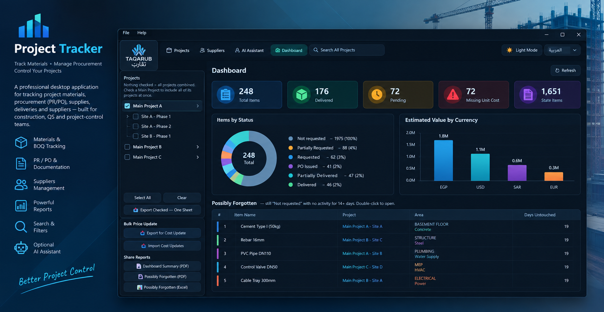

# Project Tracker

**A professional desktop application for tracking project materials, procurement (PR/PO), supplies, deliveries and suppliers — built for construction, QS and project-control teams.**


-41CD52?logo=qt&logoColor=white)


---

## What is Project Tracker?

Project Tracker is an **offline-first** Windows desktop application that replaces the classic "materials spreadsheet" used on construction sites: a BOQ/items tracker with automatic status logic, purchase-request/order documentation, supplier management, a management dashboard, professional Excel/PDF reports, and an **optional AI assistant** that can answer questions about your data in Arabic or English.

Everything lives locally in a single SQLite database plus an attachments folder — no server, no accounts, no internet required (the AI assistant is the only optional online feature).

---

## Highlights

| | Feature |
|---|---|
| 📦 | **Materials / BOQ tracker** — quantities, requested, delivered, remaining, unit cost, live totals |
| 🎯 | **Automatic status engine** — Not requested → Partially Requested → Requested → PO Issued → Partially Delivered → Delivered, with warnings for over-supply, over-request and delivered-without-request |
| 📑 | **Procurement documentation** — PR / PO / Reference plus 7 post-delivery/handover categories (Warranty, O&M Manual, Test Certificate, As-Built Drawing, Spare Parts List, MIR, Invoice), with a "Missing PR/PO" column and filter |
| 📊 | **Dashboard** — project picker (with Main Project groups), KPI cards, status donut chart, estimated value by currency, and a "Possibly Forgotten" report |
| 🔎 | **Search All Projects** — column checkboxes, scope (project / group / all), three match modes including word-order-independent Arabic/English search, and "Matched In" evidence |
| 🧾 | **Excel & PDF reports** — full project report, filtered-view export, multi-project workbook, combined sheet, cost-update round-trip, dashboard summary PDF — **with full Arabic rendering** (shaped, bidi-correct) and your **company logo** in the letterhead |
| 🗂️ | **Main Project (Group) structure** — group related section-projects, with safe automatic migration of legacy tags |
| ♻️ | **Undo everywhere** — every delete is a soft delete with an Undo snackbar, plus Trash screens with Restore / Delete Forever |
| 💾 | **Data safety** — automatic daily database backup (14-day retention), full zip backup, crash-consistent snapshots (SQLite backup API) |
| 🌐 | **Arabic & English UI** with RTL layout, and **Dark / Light themes** |
| 🤖 | **Optional AI assistant** — ask questions about your projects ("what's still pending on site A?"), persisted conversation per project/group, quick reports (OpenRouter free-tier friendly) |
| ⌨️ | **Keyboard-first** — full shortcut set (Ctrl+N/E/D/G, Alt+↑/↓, F2 inline edit, Enter to open), inline editing, bulk edit, find & replace |
| ✅ | **261 automated regression tests** — status logic, sequence integrity, migrations, search, exports, backups, attachment portability and UI scope handling |

---

## Screens

| Screen | What it does |
|---|---|
| **Projects** | Project list with group filter, search by name/number, Excel import, filtered export, Trash |
| **Items / BOQ Tracker** | The heart of the app: filters (status / supplier / area / missing cost / missing PR-PO), inline editing of Unit Cost, Requested and Delivered quantities, reordering with automatic gap-free numbering, bulk edit, find & replace, activity log |
| **Dashboard** | Cross-project KPIs, status chart, "Possibly Forgotten" items, bulk price update via Excel round-trip, shareable PDF/Excel reports |
| **Suppliers** | Shared supplier directory used across all projects |
| **AI Assistant** | Optional chat over your data with per-scope saved conversations |

---

## Quick start

```bash
# 1) Python 3.11+ required
pip install -r requirements.txt

# 2) Run
python main.py
```

**First run:** the app asks you to choose a data folder (local disk or a shared/network folder). It stores `project_tracker.db` and the `attachments/` there; your choice is remembered in `config.json` next to the app.

---

## Build a standalone .exe

```bash
pyinstaller --noconfirm --clean ProjectTracker.spec
```

The finished `ProjectTracker.exe` appears in `dist/`. To use the AI assistant in the packaged build, copy your `.env` file next to the `.exe` (see below).

---

## Optional: enabling the AI Assistant

1. Create a free account at [openrouter.ai](https://openrouter.ai) and generate an API key at [openrouter.ai/keys](https://openrouter.ai/keys).
2. Copy `.env.example` to `.env` **next to `main.py` (or next to the `.exe`)**, then set:
   ```env
   OPENROUTER_API_KEY=your-key-here
   OPENROUTER_MODEL=meta-llama/llama-3.3-70b-instruct:free
   ```
3. Open **AI Assistant → 🔌 Test AI Connection** — it reports the model, latency, and the exact `.env` path it looked for, so misconfiguration is visible immediately.

> Note: Windows sometimes saves the file as `.env.txt` when file extensions are hidden — the connection test detects and calls this out.

---

## Tests

```bash
python -m unittest discover -s tests
```

261 tests covering: status-logic edge cases, sequence integrity (gap-free numbering), soft delete/restore/trash, schema migrations (fresh, old-shaped, idempotent), Arabic and word-order-independent search, bulk find & replace, Excel cost round-trip, PDF export (including Arabic text), automatic backups, portable attachments, numeric import validation, translated status filtering, remembered table views, explicit dashboard scopes, delayed AI replies, language switching across every screen, background worker handling, numeric inline editing, scaled table layouts, the config store, the frozen-layout self-heal regression, mouse-driven Move/Bulk Edit menus (including submenus, dialogs, Arabic, and keyboard shortcuts), sorted inline edits, hidden selections, deletion provenance, legacy groups, import identifiers, PDF previews, and background-worker lifetimes. See BUG_REVIEW.md for the latest findings.

The Items screen offers saved **All Columns / Delivery / Costs / Documents** views. Less-used filters live under **More Filters**, and secondary commands under **More Actions**. Use the **Interface Size** menu for standard, large or extra-large text. On the Dashboard, **All Projects** is an explicit option; clearing the selection shows an empty scope.

Attachments are stored relative to the data folder. Legacy absolute paths are converted automatically when opening the database, so moved and restored copies use their own attachments. Excel imports report invalid, negative or non-finite quantities/prices instead of replacing them with zero; expand the import result's details to see every rejected row.

---

The Projects screen uses an expandable Main Project tree and a summary on the right. Selecting a project shows its name, metadata, item counts, delivery progress and purchasing value; selecting a group shows its combined summary. Standalone projects have an Ungrouped branch. BOQ and Schedule have grouped quick project pickers. The BOQ table uses the full width, with bulk actions for selected rows. Active filter chips can be removed individually and totals are shown separately for each currency.

Project summary cards open the project's BOQ with the selected status filter; group cards open a review list limited to that group's projects. Dashboard cards for total items, missing costs, missing documents and stale items open scoped review lists. Attachments are grouped by document category, with a resizable file list and preview, multi-file uploads, metadata and undoable removal.

## Project structure

```
main.py                     # Entry point, main window, navigation, theme/language, backups
config.py                   # Remembered preferences (data folder, layouts, company logo)
constants.py                # Statuses, colors, currencies, status-calculation rules
i18n.py                     # English/Arabic string table
database.py                 # SQLite data layer (soft delete, ordering, audit log, search)
app_paths.py                # Correct paths in source and frozen (.exe) builds
backup.py                   # Automatic daily, crash-consistent database backups
ui/
  styles.py                 # Dark & Light QSS themes
  items_page.py             # Tracker screen (the heart of the app)
  dashboard_page.py         # Cross-project dashboard
  projects_page.py          # Projects list + groups + Trash
  suppliers_page.py         # Suppliers directory
  ai_page.py                # AI assistant screen
  dialogs.py                # Add/Edit dialogs + attachments
  table_utils.py            # Shared table helpers, export workers, empty states
  global_search_dialog.py   # Search All Projects
  bulk_edit_dialog.py       # Bulk edit across selected items
  find_replace_dialog.py    # Find & Replace with live preview
  import_excel_dialog.py    # Import from Excel with column mapping
export/                     # Excel & PDF report generators
importers/                  # Excel import / cost-update import
ai/                         # OpenRouter client (optional)
tests/                      # 261 unittest regression tests
assets/cover.jpg            # README cover
```

---

## Data safety & backups

- **Every delete is undoable** (soft delete + Trash).
- **Automatic daily backup** of the database on startup (most recent 14 kept, stored in `backups/` next to your data).
- **File → Backup Now…** creates a full zip (database + all attachments) in the background, using SQLite's own backup API so the snapshot is always consistent.
- Item numbering is always compacted to a clean 1..N sequence, and migrations are idempotent — existing databases are upgraded in place, never rebuilt.

---

## Tech

Python 3.11+ · PySide6 (Qt 6) · SQLite · openpyxl · reportlab · matplotlib · arabic-reshaper + python-bidi (Arabic PDF shaping) · python-dotenv · requests (OpenRouter).

No installer, no background services, no telemetry.

---

## العربية

**Project Tracker** تطبيق سطح مكتب احترافي لمتابعة بنود المشاريع ومشترياتها وتوريدها — مصمّم لمهندسي المشاريع والكميات:

- **متابعة البنود (BOQ):** الكميات، المطلوب، المورَّد، المتبقي، التكلفة، وإجماليات حيّة.
- **حالات تلقائية:** من "لم يُطلب" حتى "تم التوريد" مع تحذيرات التوريد/الطلب الزائد والتوريد بلا طلب.
- **توثيق المشتريات:** طلبات وأوامر الشراء والمراجع + 7 فئات مستندات ما بعد التوريد (ضمان، O&M، شهادات، مخططات As-Built، قطع غيار، MIR، فواتير)، مع عمود وفلتر "PR/PO المفقود".
- **لوحة متابعة:** مؤشرات، رسم دائري للحالات، القيمة التقديرية بالعملات، وقائمة "منسي محتمل".
- **بحث شامل** في كل المشاريع (عربي/إنجليزي، بغض النظر عن ترتيب الكلمات) مع بيان أين تحققت المطابقة.
- **تقارير Excel وPDF** احترافية **بالعربية الكاملة** وترويسة تحمل **شعار شركتك**.
- **دعم كامل للعربية (RTL)** وواجهات داكنة/فاتحة.
- **أمان بيانات:** كل حذف قابل للتراجع، ونسخ احتياطي تلقائي يومي + نسخة كاملة مضغوطة.
- **مساعد ذكي اختياري** للإجابة عن أسئلتك حول المشاريع (يتطلب مفتاح OpenRouter مجاني).

---

## License

Personal / internal-use project. See the repository owner for usage terms.
